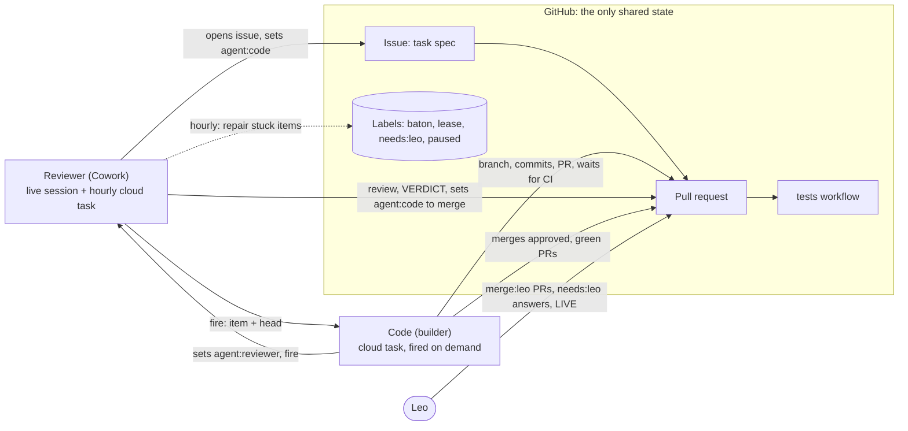

# Autonomous development: audit and design

**Status:** written by the Reviewer on 2026-10-21. Leo answered B1 to B4 the same day (section 2.5). Switched on so far: the labels, the kill-switch issue (#11), the ruleset on `main`, and the public-repository rules in both prompts. Not switched on: the cloud task for Code, Code waking the Reviewer, the CI guard step and the `main` push alarm. Until a cloud task for Code exists, Code works in Leo's own Code session and both agents look at GitHub about every 20 minutes (section 3, "Until then").

**Question asked by Leo (2026-10-21):** can Cowork (the Reviewer) and Claude Code (Code) hand work to each other through GitHub without Leo relaying messages, with a reconciliation check about every 5 minutes, while Leo keeps the business, security and LIVE decisions?

**Short answer:** yes for the hand-offs, but not with a 5-minute poll. The reliable design is event-driven: each agent wakes the other directly when it hands over, GitHub holds all state, and one hourly check repairs anything that got stuck. A 5-minute poll is either session-bound, best-effort or over the free GitHub Actions budget (section 6).

## 1. Answers to the seven questions

| # | Question | Answer | Evidence |
| --- | --- | --- | --- |
| 1 | Is there an exact 5-minute scheduler in Cowork? | No. Cloud scheduled tasks run at most once an hour. The in-session timer can run every few minutes but only while one session is alive and idle, and it is lost on a restart. A one-shot reminder can be chained, but it arrives 11 seconds to 6 minutes late. | V7, V9, V10 |
| 2 | Can GitHub reliably start Claude Code on "issue assigned", "task ready", "PR updated" or "CI failed"? | Not as the system stands. Cloud-task GitHub triggers cover pull request and release events only (no issues, no comments, no CI results), need the Claude GitHub App, and drop events above an hourly cap. The GitHub Action for Claude covers all four events but needs the App, a token stored as a repository secret, and Actions minutes. Neither is set up: no workflow uses the Action and no task has a GitHub trigger. | V4, V17, V19, N11 |
| 3 | How can Cowork and Code exchange work without a manual relay? | GitHub is the shared record (issues, labels, pull requests, comments). The hand-off itself is a direct wake: the agent that hands over fires the other agent's cloud task, with a short hint naming the item. The woken agent reads the state from GitHub, never from the hint. | V8 (Cowork side tested); N2 (Code side to test in the pilot) |
| 4 | Should the 5-minute reconciliation be a GitHub Actions schedule or a persistent worker? | Neither. An Actions schedule every 5 minutes bills at least 8,640 minutes a month against 2,000 free minutes, is best-effort, and needs a stored token to wake an agent. A persistent worker needs a machine and stored credentials. Use event wakes for speed and the existing hourly cloud task for repair. | V14, V15, section 6 |
| 5 | How are duplicates, conflicts, repeated failures and endless retries prevented? | One baton label per item (only its holder acts), a lease label with a claim comment, the head commit as the idempotency key, a re-read before every post, attempt caps, a "no change, no hand-off" rule, a kill switch, and the platform's hourly caps. | section 5 |
| 6 | Credentials, permissions, branch protection, tests, security escalation? | The design adds no new secret. Both agents act as Leo's GitHub user through Anthropic's proxy, so a label or comment can never prove that Leo acted; Leo's merge click is the gate for every halt. At the audit `main` had no protection (a private repository on GitHub Free cannot have it); since Leo made the repository public (B1) the ruleset "Main" has protected it (pull request required, the `test` check required, no force push, no deletion, no bypass; verified 2026-10-21 08:36 Manila). Tests gate approval by rule; a planned CI guard step and the `needs:leo` label enforce escalation. | V1, V13, section 2.5, section 7 |
| 7 | Which operations run on their own and which halt? | Section 8 lists both. In short: building, testing, reviewing, docs and (by Leo's B4) merging approved, green pull requests run on their own; LIVE, `clasp`, secrets, access, roles, deletion, and the merge of any pull request that touches workflows, `CLAUDE.md` or the access settings halt for Leo. | section 8 |

## 2. Audit of the current state

Checked from the Reviewer's session on 2026-10-20 between 19:00 and 20:40 UTC (2026-10-21 03:00 to 04:40 Manila time). Each item is in exactly one class. The tables are the audit record: V1, V3 and V13, and the items in 2.3, describe the state **as audited**; section 2.5 records what Leo changed afterwards (public repository, ruleset on `main`, labels, kill-switch issue).

### 2.1 VERIFIED

| ID | Finding | Evidence |
| --- | --- | --- |
| V1 | (As audited; see 2.5.) The repository is private; the default branch is `main`; `main` is not protected. Rulesets cannot be used on this plan. | `GET /repos/.../branches/main` returns `"protected": false`. `GET /repos/.../rulesets` returns 403 "Upgrade to GitHub Pro or make this repository public to enable this feature." |
| V2 | Merge commits and squash merges are allowed; auto-merge is off; branches are not deleted on merge. | `GET /repos/...`: `allow_merge_commit: true`, `allow_auto_merge: false`, `delete_branch_on_merge: false`. |
| V3 | (As audited; see 2.5.) No issues exist and only GitHub's default labels exist. | `GET /repos/.../issues?state=all` has no issues; the label list holds only the defaults. |
| V4 | One workflow, `tests` (`.github/workflows/test.yml`): runs on every pull request and on pushes to `main`; `GITHUB_TOKEN` is read-only (`contents: read`); one job: `npm ci`, `npm test`, `npm run build`, Playwright. It has no `concurrency` and no `timeout-minutes`. | The workflow file on `main`. |
| V5 | Ten workflow runs exist. A run takes 66 seconds to 9 minutes (docs-only runs about 1.5 minutes; the push to `main` after PR #7 6.5 minutes; PR #8 about 9 minutes). | `GET /repos/.../actions/runs`, start and end times. |
| V6 | One run failed on a docs-only commit (run 39481209264, PR #9, 2026-10-20 19:10 UTC); the next commits passed. A flaky browser test is the likely cause. | Run list. The log could not be read from this session (proxy 403), so the cause is N8. |
| V7 | A cloud scheduled task cannot run more often than once an hour. | A more frequent schedule was rejected when the Reviewer's task was created; the Claude Code documentation states "The minimum interval is one hour". |
| V8 | The Reviewer's cloud task, "TLMI-AI: review Claude Code's pull requests", runs hourly at minute 46 UTC on Sonnet 5.5, with automatic approval and push notifications to Leo. Its last scheduled run (19:46) started at 19:47:35 and succeeded. The Reviewer's live session fired it on demand at 20:34:07; the run was created within a second and recorded as succeeded at 20:34:30. | `list_triggers` (`last_run`), `fire_trigger` result. The work done inside the 20:34 run was not inspected (N7). |
| V9 | The live session's 4-minute check (`CronCreate`) works only while that session is alive and idle; it was lost on two session restarts; recurring jobs of this kind expire after 7 days. | Observed twice in this session; tool description. |
| V10 | One-shot reminders into a session (`send_later`) survive restarts. Eight past reminders arrived 11 s, 26 s, 30 s, 36 s, 38 s, 85 s, 87 s and 5 min 54 s after their set time. A probe set for 20:35:00 fired at 20:35:22 while the session was busy; it waited as a queued notification and was read at 20:47:42, when the turn ended. A wake into a busy session is therefore only as fast as that session's current turn. | `list_triggers` with completed tasks (`run_once_at` against `last_fired_at`); probe `TLMI audit probe: send_later latency`. |
| V11 | The Reviewer's session is woken by CI events on pull requests it opened; new comments on those pull requests did not wake it. | Observed on PR #9. |
| V12 | Code is not currently reacting to GitHub on its own. Its last GitHub comment is from 2026-10-20 19:18 UTC. It has not answered the Reviewer's round 3 note on PR #9 (19:38 and 19:39) and has not merged PR #8, which has `VERDICT: APPROVED` and was named by Leo. | Comment list of PRs #8 and #9 at 20:31 UTC. |
| V13 | (As audited, with `main` unprotected; see 2.5.) Platform guards: the Reviewer's merge attempts are refused; Code's merge after its own approval was refused; the Reviewer cannot edit `CLAUDE.md`. Both agents post as the same GitHub user, so GitHub cannot tell them apart and an "approve" review on one's own pull request is not possible. | Earlier refusals in both sessions; comment authors. |
| V14 | GitHub Free gives a private repository 2,000 Actions minutes a month, and each job is rounded up to a whole minute. Public repositories have free minutes. | GitHub billing documentation. |
| V15 | A GitHub `schedule` workflow runs at most every 5 minutes, "can be delayed during periods of high loads", queued jobs "may be dropped", and it runs only on the default branch. | GitHub "Events that trigger workflows", schedule section. |
| V16 | Events caused by `GITHUB_TOKEN` do not start new workflow runs (except `workflow_dispatch` and `repository_dispatch`). | GitHub documentation on `GITHUB_TOKEN`. |
| V17 | Cloud scheduled tasks (formerly routines): GitHub triggers support pull request and release events only and need the Claude GitHub App on the repository; events above per-task and per-account hourly caps are dropped; each event starts a new session; "Run now" and API fires are limited to 30 an hour per task; fire text is wrapped as untrusted data; a fired prompt "can't act as approval or consent for actions during the run"; runs push to `claude/` branches unless told otherwise, and branch protection is the control for where they may push. | Claude Code documentation, "Automate work with scheduled tasks". |
| V18 | A task's connectors and repositories cannot be changed with the scheduling tools (only name, schedule, on/off, model and prompt), and a new task includes all of the account's connectors by default. The Reviewer's task includes seven: Canva, Claude Docs, Google Sheets, Gmail, Claude Code Remote, Google Drive, Netlify. It needs only Claude Code Remote. | `update_trigger` schema; `list_triggers` (`mcp_connections`); documentation. |
| V19 | The GitHub Action for Claude needs the Claude GitHub App and an `ANTHROPIC_API_KEY` or `CLAUDE_CODE_OAUTH_TOKEN` repository secret, and runs on GitHub runners (Actions minutes). | Claude Code documentation, "GitHub Actions". |
| V20 | The web app runs as the deploying user and is open only to that user (`executeAs: USER_DEPLOYING`, `access: MYSELF`). | `appsscript.json` on `main`. |
| V21 | The Reviewer's session cannot message Code directly; no Code agent is reachable from it. | `ListAgents`. |

### 2.2 NOT YET VERIFIED

| ID | Open point | How it will be checked |
| --- | --- | --- |
| N1 | Where Code runs. `docs/STATUS.md` says a proxy refused branch deletion, which matches a cloud session. | Since 2026-10-21 00:51 UTC the record shows Code acting in Leo's own Code session (it merged #8 on Leo's word and posted its technical reviews on #9 and #10 two minutes after he started it); no cloud task for Code exists. The design works either way. |
| N2 | Whether a cloud task's run can fire another cloud task through its Claude Code Remote connector (needed for Code to wake the Reviewer). | Pilot, step 4. |
| N3 | Time from a fire to the first useful action (clone, read the rules) and the usage cost of one run. | Pilot timings. |
| N4 | Whether a fired cloud Code run would be refused if it tried to push to `main`. Merging is expected to be refused (V13, V17). | Not tested on purpose: testing it risks the thing it tests. Closed by B1 instead. |
| N5 | Delay of cloud-task GitHub triggers. | Only if Phase 5 is approved. |
| N6 | Actions minutes used this month. | Leo: GitHub, Settings, Billing and plans. |
| N7 | What the 20:34 run of the Reviewer's task actually did (it ended 23 seconds after the fire). | Leo can open it from claude.ai/code (scheduled task history). |
| N8 | Cause of the failed run 39481209264. | Pilot task. |
| N9 | Whether the repository has any Actions secrets. | Leo: Settings, Secrets and variables, Actions (expected: none). |
| N11 | Whether the Claude GitHub App is installed on the account (the installations list cannot be read from this session). | Leo: GitHub, Settings, Applications. Not needed by the recommended design. |
| N12 | Whether the platform lets a fired cloud Code run merge a pull request (B4). A fired prompt is not consent (V17), and Code's merge was refused once before (V13). | Pilot P-2, step 6. If refused, Leo clicks Merge. |

### 2.3 NOT IMPLEMENTED

As audited. Done since, and recorded in 2.5: the nine labels, the kill-switch issue (#11), the ruleset on `main`, and the public-repository rules in both prompts.

- Issues as work items and an issue template (issues #12 and #13 exist, written by hand).
- A cloud task for Code, and Code waking the Reviewer.
- Reconciliation logic (stale batons, stuck leases) in the hourly task (written in the Reviewer prompt, not yet run).
- CI guard step (secret and ID scan, protected paths), a `main` push alarm, `concurrency` and `timeout-minutes` in `tests`.
- Removing unneeded connectors from the Reviewer's task (B3).

### 2.4 BLOCKED — DECISION REQUIRED (Leo)

| ID | Item | Options |
| --- | --- | --- |
| B1 | `main` cannot be protected on a private repository under GitHub Free (V1). | (a) Upgrade the account to GitHub Pro and protect `main`: pull request required, the `test` check must pass, no force push, no deletion. **Recommended.** (b) Make the repository public: free protection and free minutes, but the code and business rules become public. Not recommended. (c) Keep it unprotected and add only the `main` push alarm (detection, not prevention). |
| B2 | A cloud task for Code would build and push branches as Leo's GitHub user with no person approving each step. This widens what runs without Leo. | Approve for the pilot only, then for Phase 2 building; or keep Code as today (started by Leo). |
| B3 | Connectors are removed only in the web page of the task (V18). | Leo removes all connectors except Claude Code Remote from the Reviewer's task now, and from the Code task when it is created. |
| B4 | Merge path. A fired run carries no word from Leo (V17), so "Leo names the pull request in the Code session" cannot work unattended. | Leo merges by clicking Merge on GitHub after `VERDICT: APPROVED` and green tests (one tap from the GitHub app). `CLAUDE.md` and `docs/COLLABORATION.md` are updated to say so; Leo or Code edits `CLAUDE.md` (the Reviewer cannot). |
| B5 | Added after Code's technical review (2026-10-21), opened by the repository becoming public: the `tests` workflow also runs `npm ci` and the tests for pull requests from forks. With no secrets and a read-only token the damage is limited, but it is free compute for anyone. A settings change, so it is Leo's. | Leo sets Settings, Actions, General, "Fork pull request workflows from outside collaborators" to "Require approval for all outside collaborators". **Recommended.** Until then the prompts ignore fork pull requests, but GitHub still runs the workflow. |

### 2.5 Leo's answers (2026-10-21, 05:22 Manila time)

| ID | Answer | What follows |
| --- | --- | --- |
| B1 | Make the repository public. | A scan before publishing (every branch, every commit, every pull request text and comment) was run and its findings were given to Leo in the session, with the options. Leo **made the repository public on 2026-10-21 (by 08:11 Manila)**; the follow-up actions from the scan are with him. Both agents now act only on issues, pull requests and comments by `lheiiyy` and never run code from other authors or forks (prompts in `docs/automation/`; the live Reviewer task was updated the same morning). Public also makes branch protection and Actions minutes free. **Done 08:36:** Leo activated the ruleset "Main" on the default branch: pull request required (no required approvals), status check `test` required, no force push, no deletion, no bypass (verified through the rulesets API). The follow-up actions from the scan are done. |
| B2 | Allowed. | The fire-only Code task is created (Phase 2). |
| B3 | No answer yet. | The Code task is not fired until its connectors are reduced to Claude Code Remote, or Leo says to go ahead without that. |
| B4 | Merging is part of Code's automatic work. | Code merges a pull request when the newest verdict (defined in 5.2) is `VERDICT: APPROVED` for its current head, the `test` check is green, it is mergeable, and it carries no `merge:leo`, `needs:leo` or `status:blocked`. A pull request whose diff touches `CLAUDE.md`, `.github/`, `appsscript.json`, a change of the permission table that the merged spec does not already decide (section 8), the `tools/` deploy scripts or `docs/automation/` gets `merge:leo`, and Leo merges it. The rule is in `docs/COLLABORATION.md` (PR #9) and takes effect when `CLAUDE.md` says the same (pilot item P-1, merged by Leo). Approver and merger stay different parties. |
| B5 | Added 2026-10-21 (see 2.4): fork pull request workflows. | Open: Leo's setting, recommended in 2.4. |

## 3. Recommended architecture



Principles:

1. **GitHub is the single source of truth.** Every decision, finding and hand-off is an issue, a label, a commit or a comment. Sessions hold no state that matters.
2. **Wake, do not poll.** The agent that hands over wakes the other one with `fire_trigger` when that is configured; the wake is optional and only shortens the hand-off (see "Until then" below). The wake text is only a hint; the woken agent re-reads GitHub and acts only if the labels agree. Both cloud tasks start a fresh session for each wake, so a wake never waits behind a busy session (V10).
3. **One baton per item.** Exactly one of `agent:code`, `agent:reviewer`, `agent:leo` is on an open item. Only its holder acts.
4. **Idempotent by head commit.** Each action records the head commit it covers (`Reviewed head <sha>`, `Code: built head <sha>`). An agent that finds its action already recorded for the current head does nothing.
5. **CI inside the run.** Code waits for the `test` check result of its own push inside the same run (about 1.5 to 9 minutes, V5), so no CI event is needed.
6. **Repair, not speed, is hourly.** The existing hourly task finds stuck items and re-fires once. Speed comes from the wakes.
7. **People keep the gates.** LIVE, `clasp`, secrets, access, roles and the merge of halt-path pull requests stay with Leo (section 8). Code merges the rest under the merge rule (B4).

Wake paths:

| Event | Who wakes | How | Expected delay |
| --- | --- | --- | --- |
| Task ready (issue gets `status:ready` + `agent:code`) | Code | Reviewer fires the Code task | about 1 s to start (V8), plus start-up (N3) |
| Code's pull request ready, question or blocked | Reviewer | Code fires the Reviewer task (N2) | same |
| Review done with changes requested | Code | Reviewer fires the Code task | same |
| CI finished on Code's push | Code (already running) | Code waits for the check in the same run | 1.5 to 9 min (V5) |
| Approved and green | Code, to merge | Reviewer sets `agent:code` and fires the Code task with `want: merge` | same as above |
| Approved, green, `merge:leo` | Leo | `agent:leo`; the Reviewer task's push notification; GitHub's own notification | when Leo looks |
| Leo comments or changes a label | the baton holder | Leo tells the live session, or the hourly task picks it up | up to 60 min |
| Anything stuck | the baton holder | hourly task re-fires once, then escalates | up to 60 min |

**Until then (today).** No cloud task for Code exists, so the Reviewer's wake to Code has nothing to fire, and the wake in the other direction (N2) is unproven. Both agents therefore look at GitHub about every 20 minutes: Code with `/loop 20m` in Leo's Code session, the Reviewer with its in-session timer. Both timers are **session-bound**: they stop when the session closes (V9), and the Reviewer's hourly cloud task is the only check that survives (V7). A hand-off then takes up to about 25 minutes instead of seconds. Nothing else in the protocol changes, because the baton label and the comments carry all state. The wake becomes the normal path when the Code task exists and N2 is proven.

## 4. Responsibilities

| Party | Does | Does not |
| --- | --- | --- |
| **Cowork, the Reviewer (head)**: the live claude.ai session when Leo is present; the cloud task "TLMI-AI: review Claude Code's pull requests" otherwise | Plans and sets priorities; writes specs, plans and task issues; decides spec, plan, design and business-rule questions within Leo's decisions; reviews each pull request and gives the `VERDICT`; writes docs; keeps TDMS alignment across modules; product-level review; fires Code; runs the hourly repair | Write application code; merge; touch LIVE; add secrets; widen access |
| **Code (builder)**: Leo's own Claude Code session today; a fire-only cloud task once it exists (B2); Leo's own session in any case for `clasp` to DEV and TEST and for the TEST smoke test | Claims an item; investigates the repository; builds with tests first; debugs; runs the tests; waits for and fixes CI; opens and updates pull requests; posts `Code: TECHNICAL REVIEW` on the Reviewer's pull requests; merges under the merge rule (B4); updates `docs/STATUS.md`; fires the Reviewer | Decide an open rule (asks with `Code: QUESTION`); approve; merge a `merge:leo` pull request; push to `main`; deploy; edit workflows or `CLAUDE.md` without `merge:leo` |
| **GitHub** | Holds the issues, labels, pull requests and comments; runs `tests`; notifies Leo | Wake an agent (nothing in GitHub calls the agents in this design) |
| **Leo** | Answers B1 to B4; merges `merge:leo` pull requests; answers every `needs:leo` item; owns LIVE and `clasp`; can pause everything | Relay messages between the agents |

The two agents do not repeat each other's work. Code builds and proves; the Reviewer judges. The Reviewer uses the CI result for the exact head commit as its fresh test run, and runs the tests itself only when CI is missing or red for that head, or when a screen changed (to look at screenshots at 1280, 768 and 375 pixels).

## 5. Coordination protocol

### 5.1 Work items

Each unit of work is a GitHub issue written by the Reviewer from the approved spec and plan. One issue becomes one pull request. The issue body follows this template:

```
Goal: one sentence.
Source: spec section(s) and plan task number(s).
Files expected: paths.
Done when: the tests that must exist and pass; the checks in CLAUDE.md that apply.
Out of scope: what must not change.
Halts: any item from docs/AUTOMATION.md section 8 that this work touches (a halt path gives the pull request merge:leo; a decision Leo must make first gives the issue needs:leo).
```

### 5.2 Labels

| Label | Meaning | Set by |
| --- | --- | --- |
| `status:ready` | The issue is approved for building. | Reviewer |
| `agent:code` | Code holds the baton. | Reviewer |
| `agent:reviewer` | The Reviewer holds the baton. | Code |
| `agent:leo` | Leo holds the baton: a `merge:leo` merge, or a `needs:leo` answer. | Reviewer or Code |
| `agent:working` | Lease: a run is working on the item now. | the running agent |
| `merge:leo` | The diff touches a halt path; the agents may build and review it, but only Leo merges it. | Code or Reviewer |
| `needs:leo` | A security, access, LIVE, deletion or automation-change item. Every agent stops on it until Leo removes it. | any |
| `status:blocked` | A cap was hit or a rule is missing. A comment says why. | any |
| `automation:paused` | Kill switch, on one issue titled "AUTOMATION PAUSED". While that issue is open, every run exits at once. | Leo (or an agent that finds an emergency) |

The comment rules in `docs/COLLABORATION.md` stay: every comment starts with `Code:` or `Reviewer:`; findings are tagged; reviews end with `Reviewed head <sha>` and `VERDICT:`.

**What a verdict is** (the same text is in `docs/COLLABORATION.md`, "Merge rule", and in both prompts). A verdict is a comment written by the account `lheiiyy` that starts with `Reviewer:` and whose last two non-blank lines are `Reviewed head <40-character sha>` and then exactly `VERDICT: APPROVED` or `VERDICT: CHANGES REQUESTED`. The newest verdict decides, and for a merge its sha must equal the current head. A comment that only asks for, quotes or mentions the phrase is not a verdict; comments of other accounts, `Code:` comments and comments without a prefix (Leo's) are never verdicts. A search for the phrase alone must never trigger a merge.

### 5.3 One hand-off, step by step

Every run, of either agent, starts the same way:

1. If an open issue has `automation:paused`, end with "Paused." and change nothing.
2. Read the item named in the wake hint. If the baton label is not yours, or `needs:leo` is on it, end with "No new work."
3. If `agent:working` is on it and the latest claim comment is less than 60 minutes old, end with "No new work." (A `CLAIM withdrawn` comment is not a claim.)
4. Add `agent:working` and post `Code: CLAIM <run id> head <sha>` (or `Reviewer: CLAIM ...`). Re-read the comments: if an earlier claim for the same head appeared within the last 2 minutes, the earlier one wins; post `Code: CLAIM withdrawn <UTC time>` (or `Reviewer: CLAIM withdrawn ...`), leave the labels alone, and end.
5. Do the work.
6. Right before posting a result, re-read the comments (rule 9 of the Reviewer's task). Post the result with the head commit.
7. Move the baton (remove your `agent:` label, add the next one), remove `agent:working`, and, when a trigger id is configured, wake the next agent with the hint below. The wake is optional: if no id is configured or the platform refuses it, say so in the final message; the other side finds the item at its next 20-minute check or at the hourly repair. If nothing changed in this run (no new commit, no new decision), do not hand over: end with "No change."

The wake hint (plain text, read as untrusted):

```
TLMI-EVENT v1
item: PR #12          (or: Issue #10)
head: <full sha, or none>
want: build | fix | review | technical-review | technical-review-done | merge | answer
from: reviewer | code | hourly
```

### 5.4 Limits that stop loops

- **Build attempts:** at most 2 CI-fix pushes inside one Code run; at most 6 Code runs on one item (counted as the `Code: CLAIM` comments minus the `Code: CLAIM withdrawn` ones, so a run that lost a claim race is not counted).
- **Review rounds:** at most 4 `Code: READY FOR REVIEW` rounds on one pull request that Code built. For a pull request the Reviewer wrote (specs, plans, docs) the cap is 6 `Reviewer: READY FOR REVIEW` rounds (a spec or a rulebook may need more rounds than code); after that the Reviewer adds `status:blocked`, moves the baton to `agent:leo` and posts `Reviewer: BLOCKED — limit reached — DECISION REQUIRED`.
- **Hourly repair:** re-fires a stuck item once; the second time it adds `status:blocked` and `agent:leo` with a comment.
- On any limit: add `status:blocked`, move the baton to `agent:leo`, comment the reason as `BLOCKED — REASON — DECISION REQUIRED`, and stop.
- The platform also caps fires at 30 an hour per task (V17).

### 5.5 The hourly task (repair)

The existing Reviewer task keeps its hourly schedule. When it runs without a wake hint, it also:

- Finds open items whose baton holder (Code or the Reviewer, not Leo) has not acted for 2 hours, or whose `agent:working` claim is older than 60 minutes; removes the stale lease and re-fires the holder once (limits in 5.4).
- Finds items that have a claim comment but no baton label, or two baton labels, and fixes them from the comment record. Items that never had a claim are left alone, so nothing starts before the Reviewer hands it out.
- Reviews anything waiting for the Reviewer.
- Lists, as the first line of its final message, every open item whose baton is `agent:leo` (what it is and why), so the push notification of the task reaches Leo (V8); nothing is posted on GitHub for this.
- Posts nothing when all is in order, and ends with "No new work."

## 6. The 5-minute question

| Option | Shortest interval | Limits | Monthly cost or load | Verdict |
| --- | --- | --- | --- | --- |
| Cloud scheduled task | 1 hour | hourly minimum (V7) | subscription usage per run | Use for repair (hourly) |
| In-session timer (`CronCreate`) | about 1 minute | only while one session is alive and idle; lost on restart; expires after 7 days (V9) | one model turn per tick | Stop once wakes work |
| Chained one-shot reminders (`send_later`) | 1 minute granularity | 11 s to 6 min late (V10); one session's context grows and is compacted | 288 model turns a day at 5 minutes | Stopgap only |
| GitHub Actions `schedule` | 5 minutes | best-effort, may be delayed or dropped, default branch only (V15); needs a task API token stored as a repository secret to wake an agent | at least 8,640 billed minutes a month at 5 minutes (12 an hour, each rounded up to 1 minute) against 2,000 free (V14); 1,440 at 30 minutes. Free since the repository became public, but still best-effort, still needs a stored token, and public scheduled workflows stop after 60 days without activity | Not recommended |
| Persistent worker (a VM or Leo's computer) | any | a machine to run and patch; stored credentials; Leo's computer sleeps | hosting cost | Not recommended |
| **Direct wake on hand-off (recommended)** | none needed | 30 fires an hour per task (V17); Code-side wake to be proven (N2) | one run per real hand-off | Use for every hand-off |

So no exact 5-minute loop is available, and none is needed: a hand-off reaches the other agent in seconds instead of up to 5 minutes, and nothing runs when nothing happens.

## 7. Permissions, credentials and security controls

**Identity.** Both agents act as Leo's GitHub user through Anthropic's git proxy. No personal access token, GitHub App token or API token is stored in GitHub or in the repository by this design. The wake uses the account's own `fire_trigger` tool, not the HTTP fire endpoint, so no fire token exists to leak.

**One GitHub user for three parties.** GitHub cannot tell Leo, the Reviewer and Code apart (V13). A label or a comment therefore never proves that Leo acted, and no design here treats one as Leo's approval. The acts that only Leo can do are the ones the platform keeps for a person: clicking Merge, his own words in a session, and the settings pages (billing, protection, connectors, Apps). Every halt in section 8 ends at one of these.

**Least privilege.**

- Each cloud task keeps only the Claude Code Remote connector (B3). It needs no Google, mail or hosting connector.
- The cloud environment keeps the default "Trusted" network allowlist; the agents need only GitHub and the npm registry.
- `GITHUB_TOKEN` in workflows stays `contents: read`.
- `clasp` credentials, Script Properties, sheet IDs and the Admin PIN never enter a cloud task. `clasp` runs only in Leo's own session, to DEV and TEST.

**Branch protection (B1), done.** The repository is public (free), and Leo activated the ruleset "Main" on the default branch at 08:36 Manila on 2026-10-21: pull request required (no required approvals, because every party is the same user), the status check `test` required, no force push, no deletion, no bypass actors (verified through the rulesets API). The earlier plan (GitHub Pro for the private repository) is dropped. Three layers apply: the ruleset, the instruction in every prompt, and the platform guards (V13); the `main` push alarm below is the fourth, still to be built.

**Public-repository settings (Leo, B5).** Anyone can open a pull request from a fork, and the `tests` workflow runs for it. Recommended: Settings, Actions, General, "Fork pull request workflows from outside collaborators", "Require approval for all outside collaborators". The workflow has no secrets and a read-only token; the setting only stops free compute for strangers. It is a settings change, so it is Leo's, not Code's.

**CI guard step (to be built by Code in Phase 3, reviewed by the Reviewer; it changes `.github/`, so the pull request carries `merge:leo` and Leo merges it).** Added to the `tests` job, so no extra job minutes:

1. Fails if the diff adds a `.clasprc.json`, a Google sheet or script ID pattern, a spreadsheet or script URL, an e-mail address outside an allow list of invented test addresses, or a token pattern. Invented test-only values stay allowed where a comment says so (Phase 1 rule).
2. Writes a "needs Leo" notice in the run summary when the diff touches `CLAUDE.md`, `.github/`, `appsscript.json` (web app access and run-as), `tools/` deploy scripts, or `docs/automation/` (the agents' prompts), or when the diff of `tests/unit/permissions-table.test.js` removes or changes a line (an added line alone is not a halt, section 8). It does not fail the run (a label cannot prove Leo cleared it); instead the pull request gets `merge:leo`, the Reviewer's `VERDICT` names the item for Leo, Code does not merge it, and Leo decides by merging or not.
3. `concurrency: { group: tests-${{ github.ref }}, cancel-in-progress: true }` and `timeout-minutes: 20`, to stop paying for superseded runs.

**`main` push alarm.** A workflow on `push` to `main` that fails, and so e-mails Leo through GitHub's failed-run notice (on by default), when the pushed commit is not the merge of a pull request that carries `VERDICT: APPROVED` for its head. With Code merging (B4), this alarm is the check that every commit on `main` came through an approved pull request.

**Escalation is enforced, not only written.** A decision that Leo must make first gets `needs:leo`, and every run exits on that label. A diff that touches a halt path gets `merge:leo` from the issue template, the guard step or either agent; Code's merge rule refuses it; only Leo merges it.

**Kill switch.** Leo opens an issue titled "AUTOMATION PAUSED" with the label `automation:paused`, from the GitHub app. Every run checks it first. Turning the two cloud tasks off at claude.ai/code/routines is the second switch.

## 8. Autonomous or halt

| Runs on its own | Halts for Leo (`needs:leo`, `merge:leo` or `agent:leo`) |
| --- | --- |
| Code merging a pull request under the merge rule (B4): `VERDICT: APPROVED` for its head, the `test` check green, mergeable, no `merge:leo`, `needs:leo` or `status:blocked` | Merging a pull request that touches `CLAUDE.md`, `.github/`, `appsscript.json`, a change of the permission table that the merged spec does not decide (see below), the `tools/` deploy scripts or `docs/automation/` (`merge:leo`) |
| Creating, labelling and commenting on issues | A merge the platform refuses (`Code: BLOCKED — merge refused`) |
| Branches, commits and pushes to feature and docs branches | Pushing to `main`; force push; deleting a branch that is not merged |
| Opening and updating pull requests | Anything on LIVE; `clasp` push (Leo's session only, DEV and TEST); Script Properties |
| Running unit and browser tests; fixing a red CI run within the limits | Adding or changing a secret, token or credential; installing a GitHub App |
| Code's technical review of the Reviewer's pull requests | Repository visibility, collaborators, branch protection, billing |
| The Reviewer's review and `VERDICT` on Code's pull requests | Widening a role, changing the permission table beyond the merged spec, or the web app access (`appsscript.json`) |
| The Reviewer's answers to `Code: QUESTION` on spec, plan, design and business rules within Leo's decisions | A business decision Leo has kept, or one that changes a decision he made |
| Docs, specs and plans on branches | Deleting data or history; anything touching real staff data |
| Re-firing a stuck item once | Changes to this automation's task settings (connectors, schedule, model) |
| | Any limit in 5.4 reached |

**The permission table** is the `PERMISSIONS` object in `src/server/AuthService.gs`; it is not a file, so a path check cannot see it. Decision of the Reviewer (2026-10-21, on Code's technical review of PR #9 and #10). It follows CLAUDE.md, which sends to Leo only a permission "that the spec does not cover", and it needs the spec to be merged first: adding an entry for a method that the merged spec lists, with exactly the roles the spec gives it, is **not** a halt, so Phase 2's pull requests E, F and H are not `merge:leo` for that reason. A changed or removed entry, a new role, or an entry the spec does not list (or lists with other roles) **is** a halt and the pull request gets `merge:leo`. The test `tests/unit/permissions-table.test.js` pins the whole table, so every change is a line in the diff; Code decides from that diff, and the Reviewer compares each added line with the spec row before approving. The wording is in `docs/COLLABORATION.md`, "Merge rule", and in both prompts.

## 9. Recovery

| Situation | What happens |
| --- | --- |
| Stop everything | Leo opens "AUTOMATION PAUSED"; resume by closing it. |
| A run failed (not "succeeded" in the task history) | The hourly task re-fires once; then `status:blocked`. |
| An item is stuck (no action for 2 hours) or a lease is older than 60 minutes | The hourly task clears the lease and re-fires once; then `status:blocked`. |
| CI stays red after 2 fixes in a run | Code posts `BLOCKED`, sets `status:blocked`, hands the baton to the Reviewer, who decides or escalates. |
| Two comments for the same head | Harmless: the earlier one counts; nothing is deleted. |
| A commit reached `main` without an approved pull request | The alarm fails; Leo decides; Code prepares a revert pull request. No force push. |
| The platform refuses Code's merge | Code posts `Code: BLOCKED — merge refused` and hands the baton to Leo, who clicks Merge. Nobody works around the refusal. |
| An item waits for Leo (`agent:leo`, `needs:leo` or `merge:leo`) | GitHub notifies Leo only for his own mentions and assignments, so the baton alone would not reach him. The Reviewer's cloud task has push notifications to Leo (V8); each hourly run lists the items whose baton is `agent:leo` as the first line of its final message (5.5), and an agent that escalates also says so in its final message. |
| Usage limit reached | Runs are refused until the window resets; the hourly task picks the items up again. |
| A session restarts | Nothing is lost: all state is on GitHub. |

## 10. Rollout phases

| Phase | Content | Acceptance | Rollback |
| --- | --- | --- | --- |
| 0. Audit (this pull request) | This document | Leo has answered B1 to B4 | Close the pull request |
| 1. Protocol | Labels created; the "AUTOMATION PAUSED" issue created and closed; the task prompts kept as files in `docs/automation/` so every change is reviewed in a pull request; Reviewer task prompt rewritten for wake hints, the start checks in 5.3 and the repair in 5.5; Leo removes connectors (B3); `docs/COLLABORATION.md` points to this document | The labels exist; one hourly run and one fired run both end "No new work." with nothing posted; a run while the pause issue is open ends "Paused." | Delete the labels; set the previous prompt file version back on the task |
| 2. Pilot (B2 allowed) | One fire-only Code task; items P-0 to P-2 handled end to end (section 11) | Section 11 pass criteria | Turn the Code task off; close the pilot issues |
| 3. Guards | Code builds the guard step, the `main` alarm and the CI settings in section 7 (the pull request touches `.github/`, so it carries `merge:leo`) | A test pull request with an invented sheet-ID pattern fails; one touching `CLAUDE.md` shows the "needs Leo" notice; superseded runs are cancelled | Revert the workflow pull request |
| 4. Steady state | Phase 2 pull requests E to H run through the protocol; the live sessions' 20-minute timers are stopped once the wakes are proven | PR E goes from issue to `VERDICT: APPROVED` with no relay by Leo; no duplicate verdicts; no push to `main` | Pause; return to Leo-started Code |
| 5. Optional | Claude GitHub App and a pull-request label trigger, so Leo's own labels wake an agent at once | Only if Leo wants faster than hourly reaction to his own actions | Remove the trigger and the App |

## 11. Pilot

Three items, in this order. Each one tests a different path.

| Item | What it is | Path it tests | Who merges |
| --- | --- | --- | --- |
| P-0 | The open pull requests: Code's technical review of #9 and #10, then the Reviewer's verdicts; #8 already approved | Hand-off both ways (by wake, N2, when configured; otherwise by the 20-minute check), technical review, hand-off to Leo | Leo (until P-1, `CLAUDE.md` still asks Leo to name each merge) |
| P-1 | Issue: bring the merge rule in `CLAUDE.md` in line with Leo's B4 and `docs/COLLABORATION.md` | Build, review, `merge:leo` | Leo (halt path) |
| P-2 | Issue: "Make the browser tests stable on docs-only commits" (failed run 39481209264, N8) | Build, CI wait and fix limits, review, Code's own merge (N12) | Code |

**Steps and measurements for P-2** (times from the GitHub record and the task history):

1. t0: the Reviewer opens the issue with the template, `status:ready` and `agent:code`, and fires the Code task.
2. t1: Code's claim comment appears (measures wake and start-up, N3).
3. t2: Code pushes a branch and opens a pull request; t3: the CI result for that head; Code fixes red runs within the limits.
4. t4: Code moves the baton to `agent:reviewer` and fires the Reviewer task; t5: the Reviewer's claim (proves N2).
5. t6: the Reviewer's `VERDICT`. On changes requested, steps 2 to 6 repeat.
6. t7: approved and green; the Reviewer moves the baton to `agent:code` with `want: merge`; t8: Code's `Code: MERGED <sha>`, or `Code: BLOCKED — merge refused` and Leo clicks Merge.
7. Kill-switch check: Leo opens "AUTOMATION PAUSED", the Reviewer fires the Code task once, Code must end "Paused." with no change; Leo closes the issue.

**Pass:** no message relayed by Leo between t0 and t8; each hand-off (t0 to t1, t4 to t5, t7 to t8) under 5 minutes when a wake is used, and under 25 minutes by the 20-minute check when it is not (the measurement records which path was used); exactly one claim and one result per head; labels always show one baton; nothing reaches `main` except the merge of the approved pull request; no secret or ID in any diff; the kill switch works; the flaky test passes 10 full runs in a row (`npx playwright test --repeat-each=10` locally) and CI is green.

**Abort:** any push to `main`, any secret or ID in a diff, two runs acting on the same head, or a limit in 5.4 hit twice. Then the Code task is turned off and the findings are written here.

## 12. Sources

- Claude Code documentation: "Automate work with scheduled tasks" (code.claude.com/docs/en/routines), "Claude Code GitHub Actions" (code.claude.com/docs/en/github-actions), "Run prompts on a schedule" (code.claude.com/docs/en/scheduled-tasks).
- GitHub documentation: "Events that trigger workflows" (schedule, workflow_dispatch, repository_dispatch), "Automatic token authentication" (`GITHUB_TOKEN` events), "About billing for GitHub Actions" (included minutes), "Actions runner pricing" ("GitHub rounds the minutes and partial minutes each job uses up to the nearest whole minute").
- Repository API responses and task history listed in section 2, read on 2026-10-20 between 19:00 and 20:40 UTC.
